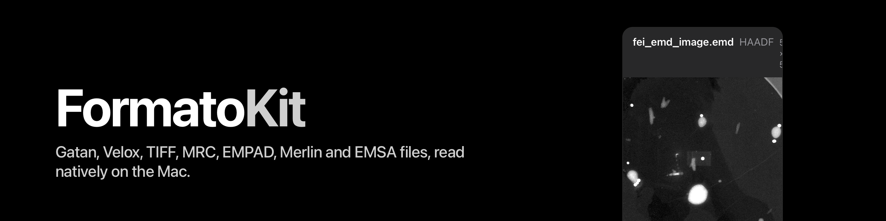

<p align="center"></p>

# FormatoKit

[](https://github.com/mac4DSTEM/FormatoKit/actions/workflows/ci.yml)
[](https://mac4dstem.github.io/FormatoKit/documentation/)
[](https://github.com/mac4DSTEM/FormatoKit/tags)
[](LICENSE)

A file-format library for macOS: the Mac counterpart of [RosettaSciIO](https://github.com/hyperspy/rosettasciio).
A Swift package of readers and writers for the electron-microscopy formats, one module per format over one data model,
checked bit for bit against RosettaSciIO at commit `049e7d70` (its signals, axes, units and metadata; where it raises, so
does FormatoKit, by name). No UI. Import it by tagged version. Swift 6 strict concurrency, headless, lazy where a file is
large, one SwiftPM product per module.

| Module | Scope | State |
|---|---|---|
| `FormatoCore` | the data model: arrays as stored, axes, units (Pint's compact units, ported), metadata with provenance, lazy signals; cancellation; `FormatoPNG` (PNG with text chunks) | reads; `AcquisitionMetadata`, `GuardedXML`, `FormatoFileWrite` |
| `FormatoDM` | Gatan DigitalMicrograph `.dm3` / `.dm4` (little-endian): every object as a signal, the tag tree, EDS and EELS spectrum images; complex, RGB and bool images are refused by name | reads; `AcquisitionMetadata.dm` |
| `FormatoEMD` | Thermo Fisher Velox `.emd`: images as signals in their stored type, titled as RosettaSciIO titles them; EDS and EELS spectrum images as signals (`VeloxSpectrumImageSignals`, with `VeloxSpectrumImageOptions` for RosettaSciIO's six options); the sparse spectrum streams; single spectra (`VeloxSpectrumSignals`, 0.9.0, "DevelopersKit" files included). Not read: NCEM / Berkeley EMD | reads; `AcquisitionMetadata.velox` |
| `FormatoHDF5` | `HDF5Datacube`: lazy rank-four numeric HDF5 / py4DSTEM EMD 1.0 hyperslabs in stored order, calibration axes, scalar metadata and lazy origin maps; the shared loader, lock and quit barrier. HSPY is not read. `BraggVectorsEMD`: write and read py4DSTEM BraggVectors (EMD 1.0 peak grid, shapes, calibration scalars), atomic publish, a hook for the caller's own attributes. EMD bundle writers: `EMDDatacubeWriter`, calibration and result maps on a write session, `HDF5NewFile` | reads and writes, pinned; `HDF5RootAttributes` (sidecar file layer: write, read, publish) |
| `FormatoTIFF` | the TIFF container with a public tag walker (any private tag as stored); FEI, Gatan DM, ImageJ, tifffile-shaped and plain TIFF as signals. Compression, tiles and the other vendors' branches are refused by name | reads; `AcquisitionMetadata.tiff` (Velox XML, FEI INI, DM stream) |
| `FormatoMRC` | MRC / MRC2014: `MRCReader` (lazy images and stacks as RosettaSciIO reads them), `MRCAppImage` (the consumer's Float32 reading), acquisition metadata (RosettaSciIO's 128-byte FEI sections, or the FEI1/FEI2 extended-header record) | reads, pinned |
| `FormatoEMPAD` | EMPAD XML + raw, memory-mapped scan / image series with calibrations; 4D HDF5 later | reads, pinned |
| `FormatoMIB` | Merlin MIB: mmap U08 (1/6-bit), U16 (12-bit), U32 (24-bit), trigger/timestamp scan shape; named app ScanX/ScanY convention; packed R64 refused | reads, pinned |
| `FormatoMSA` | EMSA/MAS spectra (`.msa`, `.ems`, `.mas`, `.emsa`): `MSAReader` and `MSAWriter`, byte-pinned to RosettaSciIO | reads and writes, pinned |
| `Formato` | the umbrella product: `FormatoLoader.sniff(path:)` (extension plus first bytes) and `FormatoLoader.load(path:)` (the signals of a DM, Velox, TIFF, MRC or MSA file); 4D formats are named, not loaded | 0.9.0 |
| `FormatoPeek` | `Peek.thumbnailFrame(url:maxPixels:)` and `Peek.summary(url:)`: one decimated frame and the header facts of a DM, Velox, TIFF, MRC, MSA or py4DSTEM HDF5 file, never more than one frame read (for Quick Look and Finder previews) | 0.10.0 |

`docs/parity.md` is the checklist against RosettaSciIO's formats table and its reader options: what reads, what is pinned,
what is next. The API reference (DocC, one page per module) is at <https://mac4dstem.github.io/FormatoKit/documentation/>.

## The first ten minutes

Add the package to your `Package.swift`
(`.package(url: "https://github.com/mac4DSTEM/FormatoKit.git", from: "0.11.0")`, or `.package(path: "../FormatoKit")` for a
clone), and the products you need (`FormatoDM`, `FormatoEMD`, `FormatoTIFF`; each brings `FormatoCore`).

To try it on files you have in hand, use the ones in this repository: planted files made for the tests, under
`Tests/*/Fixtures`. The snippets below name them relative to a clone's root, so run them from there. RosettaSciIO's own
test data (`rsciio/tests/data` in its repository, `dm`, `emd` and `tiff` folders) reads the same way.

A Gatan file, `Tests/FormatoDMTests/Fixtures/eels-planted.dm4` (21 objects: images and EELS spectrum images; the ones of a type FormatoKit does not read are printed as refused):

```swift
import FormatoCore
import FormatoDM

let dm = try DMFile(path: "Tests/FormatoDMTests/Fixtures/eels-planted.dm4")
for object in dm.objects {
    do {
        let lazy = try dm.signal(index: object.index)      // nothing read yet
        print(lazy.title, lazy.array.dataType, lazy.array.shape, lazy.axes.map(\.units))
        let signal = try lazy.load()                       // the stored bytes, C order, little-endian
        print(signal.metadata["Acquisition_instrument.TEM.beam_energy"]?.provenance.source ?? "-")
    } catch {
        print("object \(object.index) refused:", error)    // a type FormatoKit does not read is refused by name
    }
}
```

A Velox file, images and then spectrum images: `velox-titles-v6-image.emd` holds 14 images, `step4/si-planted-v11.emd` one
EDS spectrum image. `VeloxSpectrumImageOptions` takes RosettaSciIO's six arguments; the defaults are RosettaSciIO's:

```swift
import FormatoCore
import FormatoEMD

let velox = try VeloxImageSignals(path: "Tests/FormatoEMDTests/Fixtures/velox-titles-v6-image.emd")
for image in velox.images {
    let signal = try velox.signal(image).load()            // the stored type, RosettaSciIO's title
    print(signal.title, signal.data.dataType, signal.data.shape)
}

let options = VeloxSpectrumImageOptions(rebinEnergy: 1)
let spectrumImages = try VeloxSpectrumImageSignals(path: "Tests/FormatoEMDTests/Fixtures/step4/si-planted-v11.emd",
                                                   options: options)
for signal in spectrumImages.signals {
    print(signal.title, signal.signalType, signal.data.dataType, signal.data.shape)
}
```

A TIFF file, `Tests/FormatoTIFFTests/Fixtures/planted/fei-helios.tif` (one image, FEI's tags):

```swift
import FormatoCore
import FormatoTIFF

let tiff = try TIFFSignals(path: "Tests/FormatoTIFFTests/Fixtures/planted/fei-helios.tif")
for n in tiff.series.indices {
    let signal = try tiff.signal(series: n).load()
    print(signal.title, signal.data.dataType, signal.data.shape, signal.axes.map(\.units))
}
```

`tools/consumer-check/readme` builds exactly these three snippets as a separate package and runs them on those files.
The example executable prints every signal of a file (axes, units, metadata with provenance, one value read lazily):

```sh
swift run formato-info Tests/FormatoEMDTests/Fixtures/velox-titles-v6-image.emd
```

A py4DSTEM EMD 1.0 datacube (select the numeric dataset explicitly; axes stay in stored order):

```swift
import FormatoHDF5

let cube = try HDF5Datacube(path: "scan.h5", datasetPath: "/cube_root/cube/data")
let frame = try cube.read(start: [0, 0, 0, 0], count: [1, 1, cube.shape[2], cube.shape[3]])
let signal = cube.signal // lazy; signal.load() reads the complete cube
```

The file must stay unchanged while the reader or its signal exists. Compressed HDF5 uses hyperslab reads through
HDF5 rather than memory mapping. `originMap(_:)` returns fitted/measured scan maps lazily. Scalar calibration datasets
and legacy attributes are kept in `calibration`, with provenance; absent values use EMD dimension vectors, then pixel
axes. Generic EMD fallback supports uniform coordinates; nonlinear coordinates throw a typed unsupported error. Rank-three promotion, dataset discovery, and app sidecar recognition are outside this API.

py4DSTEM BraggVectors, written and read through the same loader (peaks are float64 `qx` = detector row, `qy` = column):

```swift
let shape = BraggGridShape(rows: 2, columns: 2), detector = BraggGridShape(rows: 256, columns: 256)
try BraggVectorsEMD.write(peaks: peaks, scan: shape, detector: detector,
                          calibration: BraggCalibration(qPixelSize: 0.01, qPixelUnits: "A^-1"),
                          to: URL(fileURLWithPath: "vectors.h5"), sourcePath: "scan.h5") // never over the source
let vectors = try BraggVectorsEMD.read(path: "vectors.h5") // py4DSTEM.read(...) opens the same file
```

The file is built beside the destination and renamed onto it, so a failed or cancelled write changes nothing.
`convention: .appImageXY` hands peaks over as image x/y (mac4DSTEM's), and `extraAttributes` lets an app add its own string
attributes to the file, root or BraggVectors group.

## Requirements

macOS 15 or later on Apple silicon, Swift 6.2 tools (Xcode 26 or later). iOS is not supported: FormatoCore uses Foundation's
macOS-only `XMLDocument`, and FormatoHDF5 and FormatoEMD load the shipped arm64 macOS libhdf5 at run time. The shipped binaries are
arm64 only: an Intel Mac cannot load them.
**libhdf5 is inside the package** (HDF5 2.1.1 with libsz and libaec, arm64, as three binary-target XCFrameworks that Xcode embeds and signs in an app), so `swift build`
and `swift test` need nothing installed. The Velox reader looks for libhdf5 in this order: the path in the
`FORMATO_HDF5_PATH` environment variable, the host app's `Frameworks` folder, the shipped copy (the `FormatoLibHDF5` framework), then the loader's path.

## Licence

GPL-3.0 (`LICENSE`, `NOTICE`). The DM and Velox readers are inherited from an earlier GPL-3.0 package (named in `NOTICE`). The signal adapters port **RosettaSciIO**'s rules (GPL-3.0-or-later, the HyperSpy developers), which is also the
oracle every reader is checked against; `FormatoUnits` ports what RosettaSciIO does with **Pint** (BSD-3-Clause) and carries
Pint's conversion factors. HDF5, libaec and libsz are BSD-style; tifffile, whose TIFF rules FormatoTIFF ports, is BSD-3-Clause. Every third-party
licence text is in `Licenses/`. One GPL part makes the package GPL-3.0: an app
built on it must be GPL-compatible.

## Build and test

```sh
tools/test.sh                      # the gate: swift test -c release, warning-checked
tools/consumer-check/run.sh        # two separate packages, public API only, Debug, no warnings, libhdf5 from the package;
                                   # the second runs this README's snippets
```

Numbers are held to the Python reference within its own tolerance; `docs/parity.md` lists each function, its state and its
tolerance. The oracle is not in the repository (`References/rosettasciio-049e7d70`, the pinned clone, and
`References/rsciio-venv`); without them the pins test runs on the committed public file and the planted files only. CI
(`.github/workflows/ci.yml`) runs the gate and the consumer check on macOS; a tag also checks that the CHANGELOG top version
matches it. Tags are made by the maintainer; what each tag changes for a consumer is in the `CHANGELOG.md` Migration paragraph.

## Known limits

- The three XCFrameworks embedded and signed by Xcode in a Developer ID archive of an app: not tried here (no signing
  identity); checked only through `swift test` and the consumer check.
- Big-endian DM files: none exists to test; not detected.
- Velox: `lazy=True` is not ported; hostile grids and bin counts were run on FormatoKit only, not
  refuted against RosettaSciIO. Deliberate deviations are listed in `docs/parity.md`.
- Performance: `docs/benchmarks.md`. DM, TIFF and the 2048² Velox image read 1.2 to 2x slower than RosettaSciIO at typical sizes (`docs/open-items.md`); MIB, MSA, MRC, EMPAD, HDF5 4D and the Velox spectrum-image decode are at parity or faster.
- TIFF: OME and SubIFD series, generic pyramids, compression and the other vendor branches are refused, not read (tifffile's shaped series are read since 0.11.0).
- Validation: none. Agreement with RosettaSciIO and recovery of planted files are what is claimed.
